# Kokpit

**Android araç multimedya cihazları için açık kaynak ana ekran.** "Android CarPlay'li
multimedya" diye satılan uygun fiyatlı MediaTek cihazlar (MT8227L, Android 8.1) için
yazıldı. Bu cihazların ana ekranı eski görünür, sistem ayarlarının bir kısmı gizlidir;
Kokpit ikisini de düzeltir.

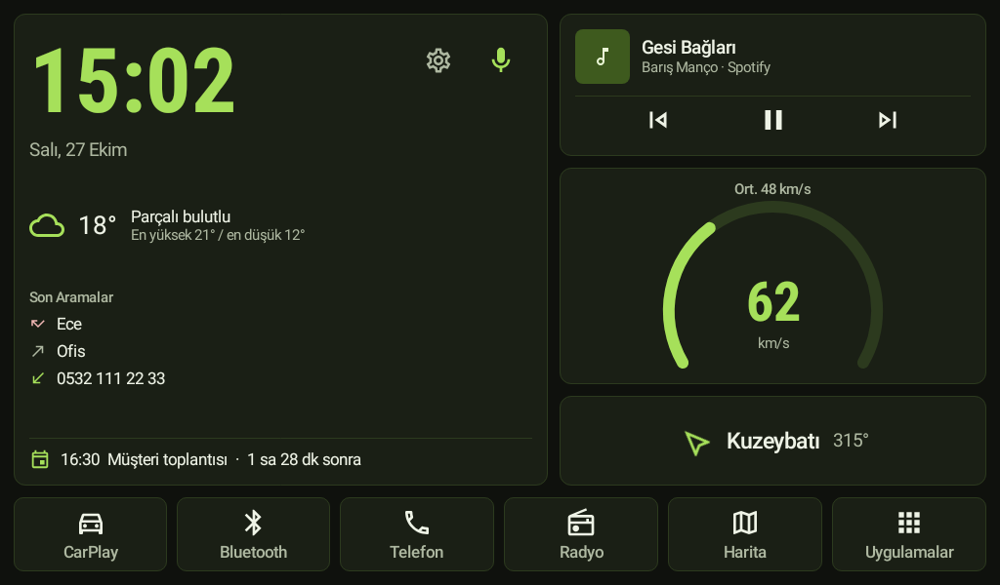

Kokpit bir ana ekran uygulamasıdır, cihaz yazılımı değildir. Root gerekmez; sistem ya da
MCU yazılımına dokunulmaz. Kaldırdığınızda cihaz eskisi gibi çalışır.

## Neler Yapar

### Ana Ekran
Büyük saat ve tarih, hava durumu, son aramalar, takvimdeki sıradaki etkinlik, çalan
müzik ve kontrolleri, GPS hız göstergesi ve yolculuk ortalaması, gidilen yön. Altta altı
büyük düğme: CarPlay, Bluetooth, Telefon, Radyo, Harita, Uygulamalar. Koyu, açık ve gün
doğumu/batımına göre otomatik tema; üç renk seçeneği.

| | |
|---|---|
| 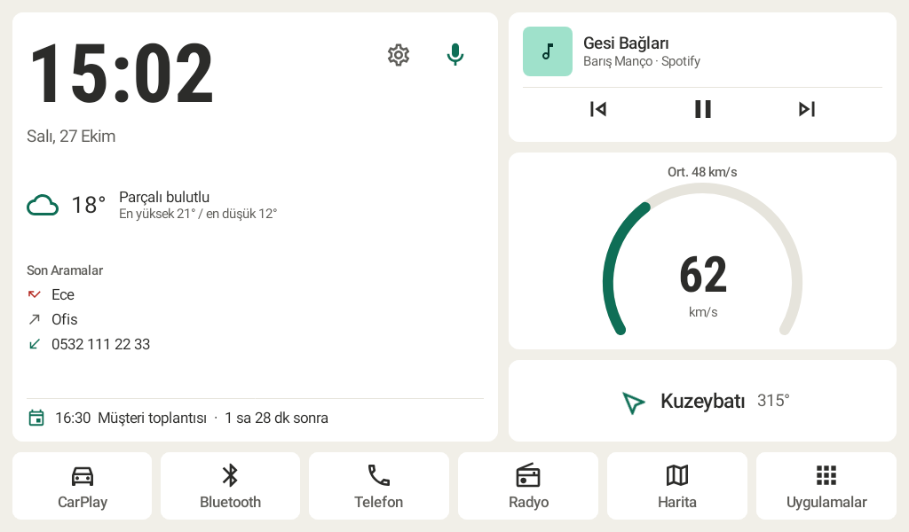 | 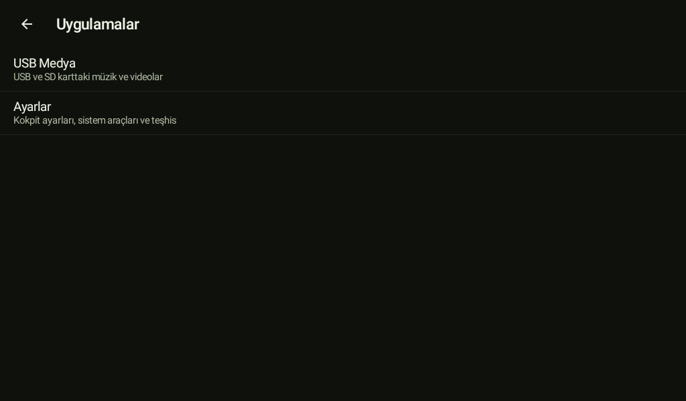 |

### Cihazın Kendi Donanımına Bağlı Ekranlar
MT8227L cihazlarda Kokpit, üreticinin servislerine doğrudan bağlanır; radyo, Bluetooth
ve telefon üreticinin uygulamasını açmadan Kokpit'in kendi ekranlarından yönetilir.

- **Radyo** – RDS'ten gelen istasyon adı, parmakla kaydırılan frekans kadranı, istasyon
  arama ve altı kayıt. Kayda dokununca istasyona geçer, basılı tutunca çalan istasyonu
  adıyla kaydeder.
- **Telefon** – son aramalar, rehber, favoriler ve tuş takımı; aramalar cihazın
  Bluetooth'u üzerinden yapılır. Gelen aramada her ekranın üstünde arama kartı çıkar.
- **Bluetooth Müzik** – telefondan çalan müziği gösterir ve yönetir.

| | |
|---|---|
| 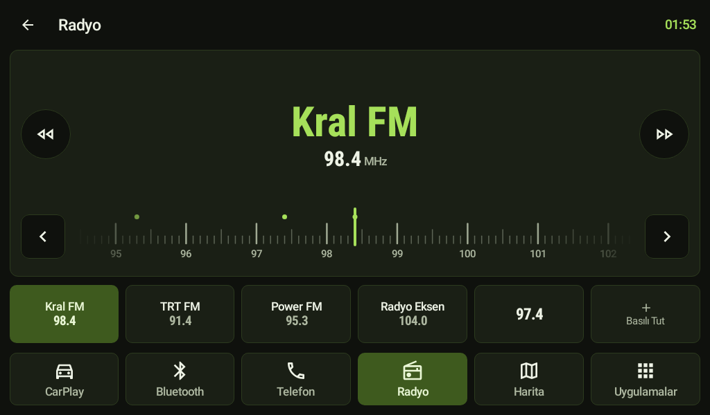 | 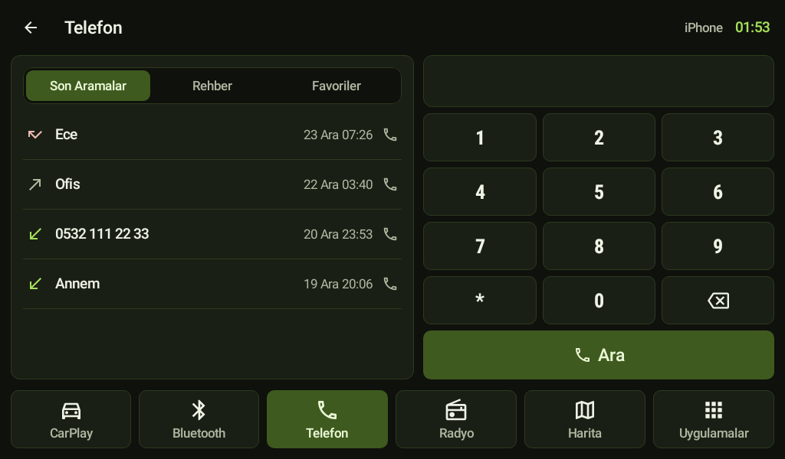 |
| 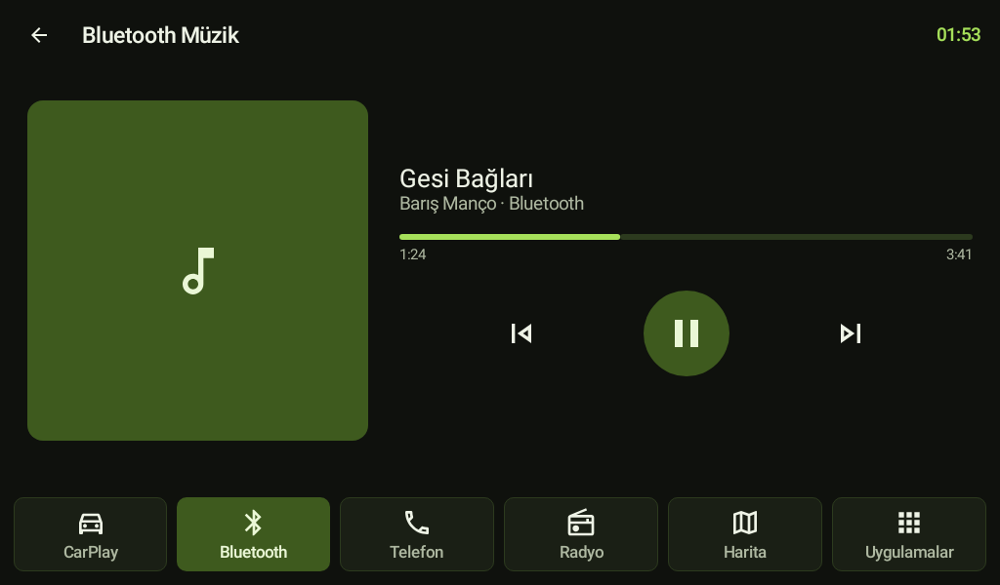 | 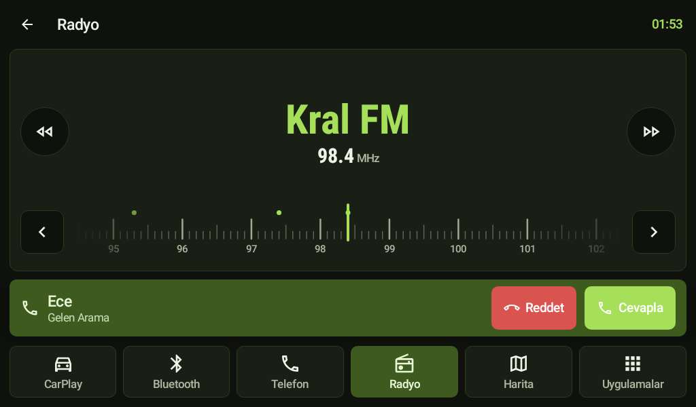 |

### Yapay Zekâ Asistanı
Ana ekrandaki mikrofona dokunup konuşun: "Kral FM'i aç", "Annemi ara", "En yakın
benzinliğe götür", "Sesi kıs", "Hızım kaç?". Asistan radyoyu ayarlar, arama yapar,
haritada yol tarifi başlatır, müziği ve sesi yönetir, uygulama açar, telefonunuzun
erişim noktasına bağlanır. Cevabı sesli okur.

Claude, OpenAI ya da Gemini ile çalışır; kendi API anahtarınızı Ayarlar'a girersiniz.
ChatGPT, Claude veya Gemini aboneliği API kullanımını kapsamaz; anahtarı sağlayıcının
geliştirici sayfasından alırsınız.

| | |
|---|---|
| 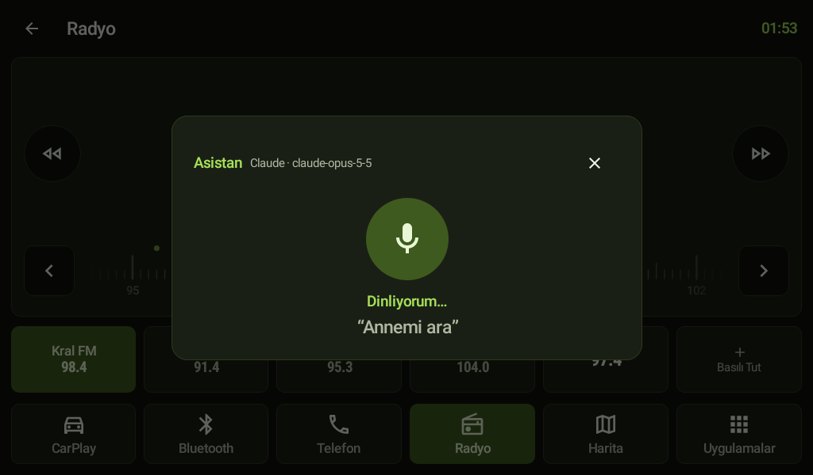 | 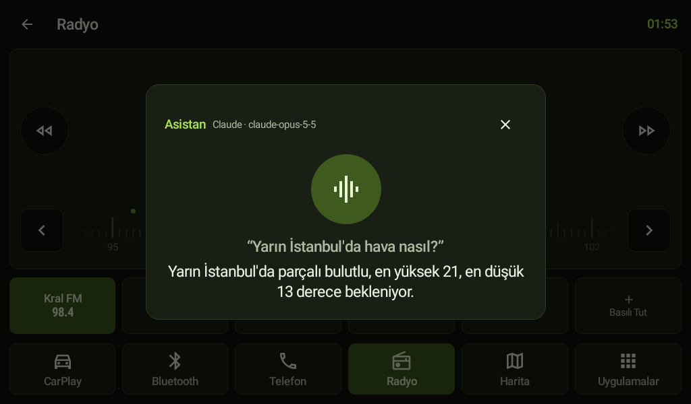 |

### USB Medya
USB bellekteki müzik ve videoları listeler ve oynatır. Araç hareket ederken video
görüntüsü kapanır, ses devam eder.

### Hızlı Ayarlar
Ses, sessiz, ekolayzır, ekran parlaklığı, tema, ekranı kapatma ve Wi-Fi tek ekranda.

| | |
|---|---|
| 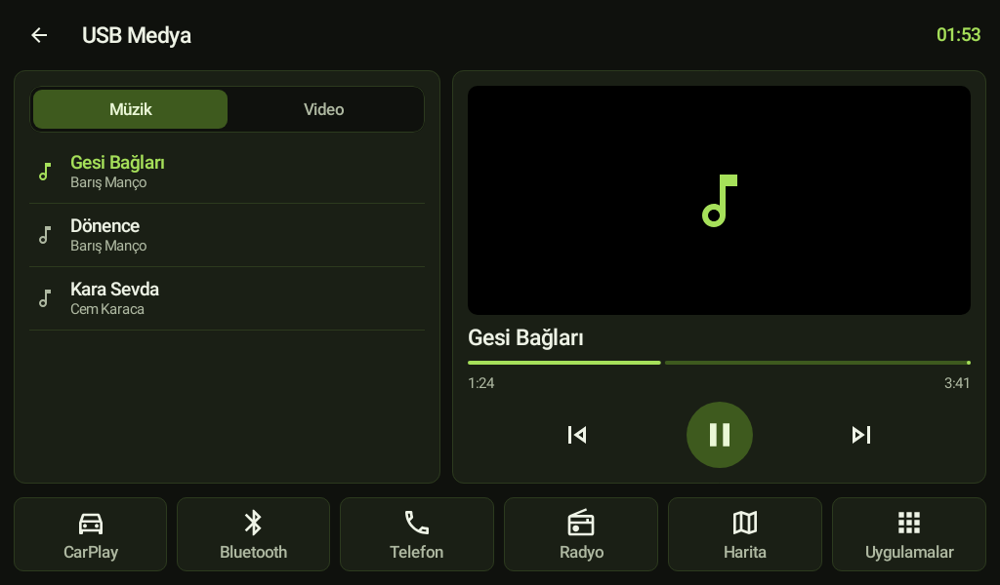 | 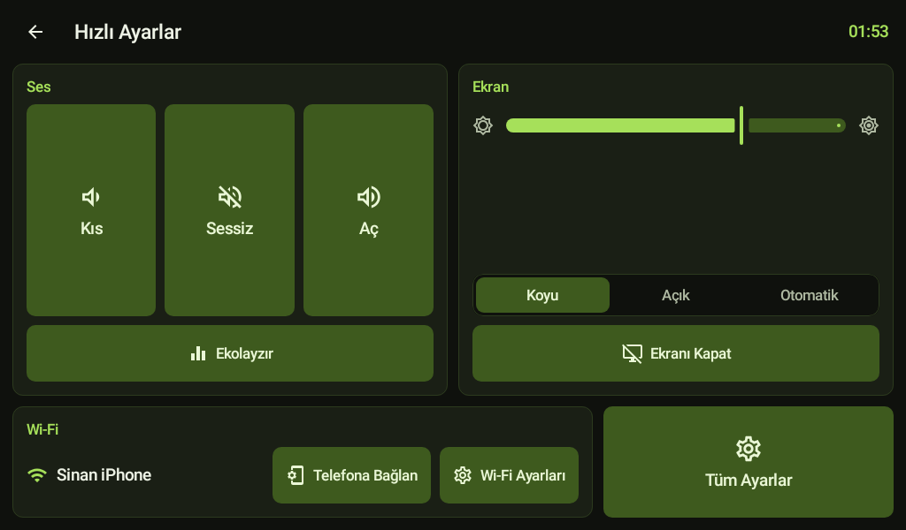 |

### Kontak Açılınca
Wi-Fi'ı açıp telefonunuzun erişim noktasına bağlanır, iPhone takılıysa CarPlay'i
açabilir ve kendi açılış videonuzu oynatır.

### Gizlenen Ayarlar Geri Gelir
Ekran kilidini değiştirme veya kaldırma, tüm Android ayarları, geliştirici seçenekleri,
varsayılan uygulamalar, tarih ve saat, dil, cihazın gizli ekranları için etkinlik
gezgini. **Teşhis** ekranı cihazın gerçek Android sürümünü, ekran ölçüsünü, Wi-Fi
bantlarını ve üretici servislerinden gelen değerleri tek yerde toplar; hata
bildirimine eklemek için USB'ye kaydedilir.

## Desteklenen Cihazlar

| | |
|---|---|
| Test edilen | MT8227L, Android 8.1 ("Android 11" diye satılır), 1024×600 |
| Çalışması beklenen | Diğer yatay Android 8.1–13 multimedya cihazları, 800×480 ile 1920×720 arası |

Radyo, Bluetooth ve telefon ekranlarının üreticinin servislerine bağlanması FF/TS
yazılımlı MT8227L cihazlara özeldir (`com.ts.MainUI`). Başka cihazlarda bu düğmeler
cihazın kendi uygulamalarını açar; geri kalan her şey çalışır.

Android 10 ve sonrasında uygulamalar Wi-Fi'ı kendisi açamaz. Bu sürümlerde Kokpit
erişim noktanızı önerilen ağ olarak ekler; Wi-Fi kapalıysa bildirim gösterir.

## USB Bellekle Kurulum

1. [Sürümler](https://github.com/yorulmazsinan/kokpit-car-launcher/releases) sayfasından
   `kokpit-<sürüm>.apk` dosyasını indirip USB belleğe kopyalayın.
2. Belleği cihaza takın, dosya yöneticisinden APK'ya dokunun. Sorulursa bilinmeyen
   kaynaklardan yüklemeye izin verin.
3. Kokpit'i bir kez açın, konum, takvim, telefon ve mikrofon izinlerini verin.

Güncellerken yeni APK'yı aynı yoldan kurmanız yeterli; ayarlarınız korunur.

### Ana Ekran Yapmak ve Geri Almak

- Ev tuşuna basıp **Kokpit → Her zaman**'ı seçin ya da Android ayarları → Uygulamalar →
  Varsayılan uygulamalar → Ana ekran uygulaması.
- Geri almak için: Kokpit'te **Uygulamalar**'a uzun basın → Ayarlar → Sistem Araçları →
  **Üretici Ana Ekranına Dön**, sonra aynı yoldan üreticinin ekranını varsayılan yapın.
- Bazı cihazlarda ev tuşu üreticinin ekranına sabitlenmiştir. Sizinki öyleyse Teşhis
  raporunu USB'ye kaydedip onunla bir [hata bildirimi](https://github.com/yorulmazsinan/kokpit-car-launcher/issues/new/choose)
  açın.

## İlk Ayarlar

- **Ekran kilidini kaldırma:** Ayarlar → Sistem Araçları → *Ekran Kilidini Değiştir veya
  Kaldır*, mevcut PIN'i girin, *Yok*'u seçin.
- **Ana ekranda çalan müzik:** müzik kartına dokunup Kokpit'e bildirim erişimi verin.
  Android çalan şarkıyı yalnızca bu izni olan uygulamalarla paylaşır.
- **iCloud takvimi:** account.apple.com'dan uygulamaya özel parola oluşturun,
  [DAVx⁵](https://www.davx5.com/)'i kurun; `https://caldav.icloud.com` adresi, Apple
  Kimliği e-postanız ve bu parolayla hesap ekleyip takvimlerinizi seçin. Google Takvim
  için ek adım gerekmez.
- **iPhone erişim noktası:** *Başkalarının Katılmasına İzin Ver* ve *Uyumluluğu En Üst
  Düzeye Çıkar* açık olsun (bu cihazların çoğu yalnızca 2.4 GHz görür). Erişim noktası
  adını ve parolasını Ayarlar → Bağlantı'ya girin.
- **Yapay zekâ asistanı:** Ayarlar → Yapay Zekâ Asistanı'ndan sağlayıcıyı seçin, API
  anahtarınızı girip Kaydet'e basın.
- **Açılış videosu:** Ayarlar → Açılış Videosu → *USB'den Video Ekle*. Videolar cihaza
  kopyalanır, sonra USB'yi çıkarabilirsiniz. MP4 (H.264), en fazla 20 MB; 1024×600 ve
  3–8 saniye en iyi sonucu verir.

## Gizlilik

Kokpit'te analitik, reklam ve hesap yoktur. İnternete yalnızca şu istekler gider:

- **Hava durumu:** yaklaşık konumunuz [Open-Meteo](https://open-meteo.com/)'ya.
- **Yapay zekâ asistanı** (yalnızca kullandığınızda): söylediğiniz komutun yazıya
  dökülmüş hali ve aracın o anki durumu (saat, hız, yön, çalan müzik, radyo frekansı),
  yalnızca seçtiğiniz sağlayıcıya (Anthropic, OpenAI ya da Google). Sesinizi yazıya
  Android'in kendi konuşma tanıma servisi çevirir.

API anahtarları ve erişim noktası parolası cihazda Android Keystore ile şifrelenir,
yalnızca ilgili sağlayıcıya gönderilir.

`QUERY_ALL_PACKAGES` izni, ana ekranın tüm uygulamaları listeleyip açabilmesi için
gerekir.

## Derleme

```bash
./gradlew :app:testDebugUnitTest :app:assembleDebug
```

JDK 17–21 gerekir. `keystore.properties` (ya da `~/.config/kokpit/keystore.properties`)
varsa yayın derlemesi imzalanır. Ekran görüntüleri Robolectric testleriyle üretilir ve
`app/build/screenshots/` altına yazılır.

## Katkı

Hata bildirimleri ve öneriler [Issues](https://github.com/yorulmazsinan/kokpit-car-launcher/issues)
sayfasından. Farklı bir cihazda denediyseniz Teşhis raporunu eklemeniz en çok işe
yarayan katkıdır.

## Lisans

[Apache Lisansı 2.0](LICENSE)
